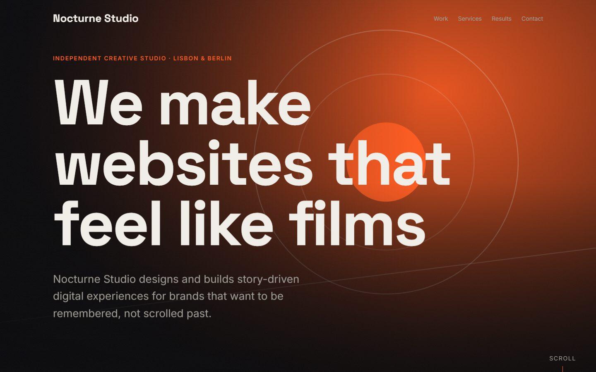
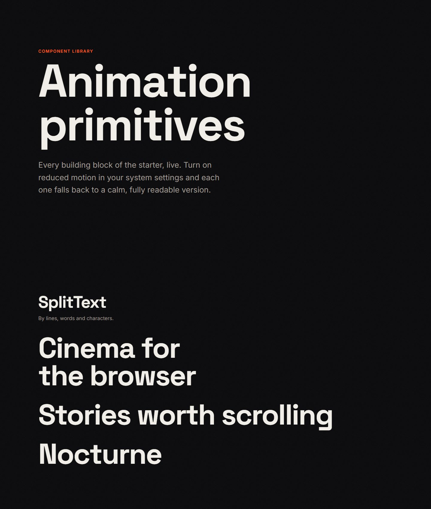

# cinematic-next-starter

[](https://github.com/codewithfaseeh59/cinematic-next-starter/actions/workflows/ci.yml)

A free starter template for cinematic, scroll-driven landing pages. Click **Use this template**, edit one config file, deploy.

Built with Next.js (App Router), React, TypeScript (strict), GSAP + ScrollTrigger, Lenis, CSS Modules, Vitest and Testing Library. The demo content is a fictional studio called Nocturne Studio.





## Quick start

```bash
npm install
npm run dev
```

Open http://localhost:3000. Every primitive is also shown live at http://localhost:3000/components.

## Make it yours

1. Edit [`src/config/site.ts`](src/config/site.ts). Every headline, project, feature, stat, testimonial and link on the page lives there, and the SEO metadata and Open Graph image are built from it.
2. Change `url` in that file to your production domain.
3. Change the accent colour and fonts in [`src/styles/tokens.css`](src/styles/tokens.css) and `src/app/layout.tsx`.
4. Replace the SVGs in `public/images/` with your own artwork.

## Deploy

Push to GitHub, import the repo on [Vercel](https://vercel.com/new), and deploy. No environment variables are needed.

## Scripts

| Command                | What it does                  |
| ---------------------- | ----------------------------- |
| `npm run dev`          | Start the dev server          |
| `npm run build`        | Create a production build     |
| `npm run typecheck`    | Type-check with `tsc`         |
| `npm run lint`         | Lint with ESLint              |
| `npm run test`         | Run unit tests with Vitest    |
| `npm run format`       | Format the code with Prettier |
| `npm run format:check` | Check formatting (used in CI) |

## Reduced motion

Every animation checks `prefers-reduced-motion`. When it is on, smooth scrolling, reveals, parallax, magnetic hover and the marquee are switched off, counters show their final number, and the horizontal showcase becomes a normal row you can scroll by hand. All content stays visible and usable.

## Built-in motion extras

Beyond the primitives, the template includes a few small touches, all switched off under reduced motion:

- A scroll progress bar at the top of the page, done in pure CSS with `animation-timeline: scroll()` (browsers without support simply do not show it).
- Smooth scrolling for in-page links such as the navigation, through Lenis.
- A hero that settles in on load, with a scroll hint that pulses.
- A progress line under the pinned Showcase section.
- Hover transitions on cards, buttons, links and project images.
- Stat dividers that draw in as they scroll into view (CSS `animation-timeline: view()`).
- A second, reversed marquee above the footer.

## Animation primitives

All live in `src/components/animation/`. Each one is a client component.

### SmoothScroll

Lenis smooth scrolling driven by the GSAP ticker so Lenis and ScrollTrigger stay in sync. Disabled under reduced motion. Wrap your app once.

```tsx
import { SmoothScroll } from "@/components/animation/SmoothScroll";

<SmoothScroll>{children}</SmoothScroll>;
```

### Reveal

Fades and slides content in when it scrolls into view.

| Prop        | Default | Description                                                       |
| ----------- | ------- | ----------------------------------------------------------------- |
| `direction` | `"up"`  | `"up"`, `"down"`, `"left"`, `"right"` or `"none"`                 |
| `delay`     | `0`     | Seconds before it starts                                          |
| `duration`  | `0.9`   | Animation length in seconds                                       |
| `distance`  | `48`    | Slide distance in pixels                                          |
| `stagger`   | none    | Seconds between direct children. Set it to reveal them one by one |

```tsx
<Reveal direction="left" delay={0.2}>
  <p>Slides in from the right.</p>
</Reveal>

<Reveal stagger={0.12}>
  <Card />
  <Card />
  <Card />
</Reveal>
```

### SplitText

Our own text splitter (see `src/lib/splitText.ts`). It renders a heading, wraps each line, word or character in a span and reveals them one after another. The original text goes in `aria-label` and the spans are `aria-hidden`, so screen readers read the heading normally.

"Lines" are the lines you write with `\n`; browsers decide wrapping, so we do not measure it.

| Prop       | Default   | Description                                        |
| ---------- | --------- | -------------------------------------------------- |
| `text`     | required  | The text to split                                  |
| `as`       | `"h2"`    | Heading level, `"h1"` to `"h6"`                    |
| `by`       | `"words"` | `"lines"`, `"words"` or `"chars"`                  |
| `stagger`  | `0.06`    | Seconds between pieces                             |
| `delay`    | `0`       | Seconds before it starts                           |
| `onScroll` | `true`    | Wait until visible. Use `false` for above the fold |

```tsx
<SplitText as="h1" text="We make websites that feel like films" by="words" onScroll={false} />
```

### Marquee

Endless horizontal ticker for text or logos. The page's scroll speed makes it faster and scrolling up reverses it.

| Prop             | Default  | Description                              |
| ---------------- | -------- | ---------------------------------------- |
| `speed`          | `80`     | Base speed in pixels per second          |
| `direction`      | `"left"` | `"left"` or `"right"`                    |
| `velocityFactor` | `1`      | How much scrolling boosts it. `0` is off |

```tsx
<Marquee speed={90}>
  <span>Brand Films</span>
  <span>Motion Design</span>
</Marquee>
```

### Parallax

Clips its children in a frame and moves them slower than the page. Give the frame a height.

| Prop    | Default | Description                                                          |
| ------- | ------- | -------------------------------------------------------------------- |
| `speed` | `0.2`   | Drift as a fraction of the frame height. Negative goes the other way |

```tsx
<Parallax speed={0.2} className={styles.frame}>
  <Image src="/images/hero.svg" alt="" fill sizes="100vw" />
</Parallax>
```

### Counter

Counts up from 0 when it enters the viewport. The final value is already in the HTML, so it is right without JavaScript.

| Prop       | Default  | Description            |
| ---------- | -------- | ---------------------- |
| `value`    | required | Number to count to     |
| `decimals` | `0`      | Decimal places         |
| `prefix`   | `""`     | Text before the number |
| `suffix`   | `""`     | Text after the number  |
| `duration` | `2`      | Seconds                |

```tsx
<Counter value={4.9} decimals={1} suffix="/5" />
```

### HorizontalScroll

Pins the section while vertical scroll slides its cards sideways. Each direct child is one card.

| Prop       | Description                            |
| ---------- | -------------------------------------- |
| `label`    | Accessible name for the region         |
| `header`   | Optional content shown above the cards |
| `children` | The cards                              |

```tsx
<HorizontalScroll label="Projects" header={<h2>Selected work</h2>}>
  <article>One</article>
  <article>Two</article>
  <article>Three</article>
</HorizontalScroll>
```

### Magnetic

Pulls its child toward the mouse while hovering, then springs back. Mouse only, so touch scrolling is never disturbed.

| Prop       | Default | Description                               |
| ---------- | ------- | ----------------------------------------- |
| `strength` | `0.35`  | Fraction of the pointer offset it follows |

```tsx
<Magnetic>
  <Button href="#contact">Start a project</Button>
</Magnetic>
```

## Project structure

```
src/
  app/            layout, home page and the /components demo route
  config/site.ts  all site content
  components/
    animation/    the primitives above
    sections/     Hero, MarqueeStrip, Showcase, Features, Stats, Testimonials, Cta, Footer
    ui/           Button, Container, Section
  hooks/          useReducedMotion
  lib/            splitText, clamp, formatNumber, animateIn, onceVisible, whenIdle, gsap setup (with tests)
  styles/         tokens.css (design tokens) and global.css
```

## Quality

- `npm run typecheck`, `lint`, `test` and `build` run in GitHub Actions on every push and pull request.
- Local Lighthouse (mobile, simulated throttling, production build, several runs): Accessibility 100, Best Practices 96, SEO 100, no layout shift. Performance is usually 85 to 88, with a best run of 90 and a worst of 72 on a busy machine, so it does not reliably reach 90 yet. To keep the main thread free, one-shot reveals use the browser's Web Animations API, heavier GSAP effects start when the browser is idle, and below-the-fold sections use `content-visibility: auto`. Run your own audit after you add your content.

## License

MIT
